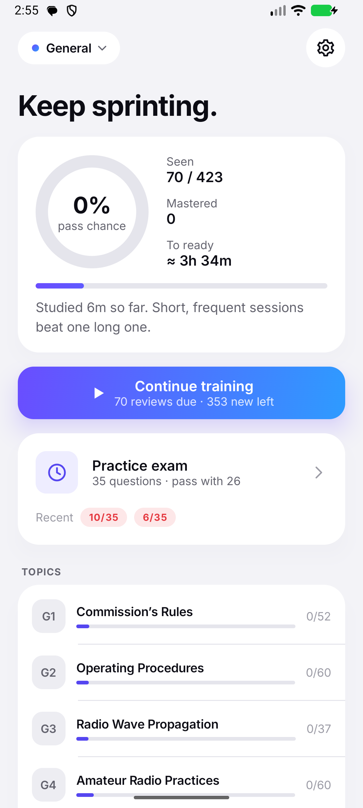
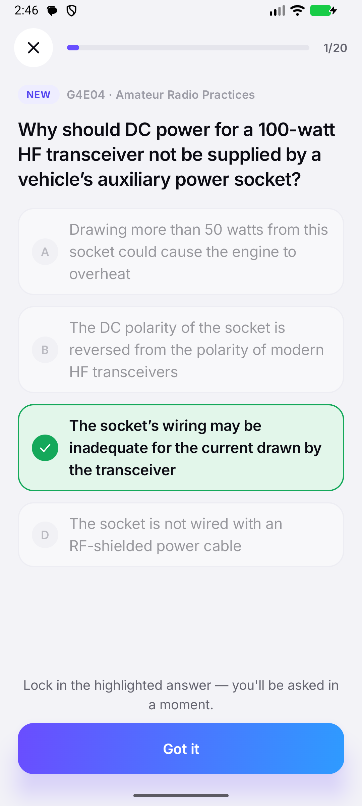
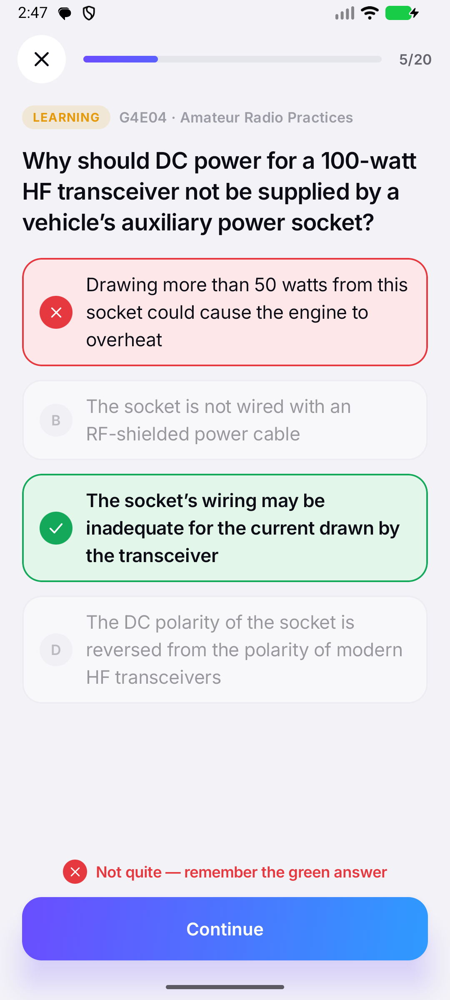
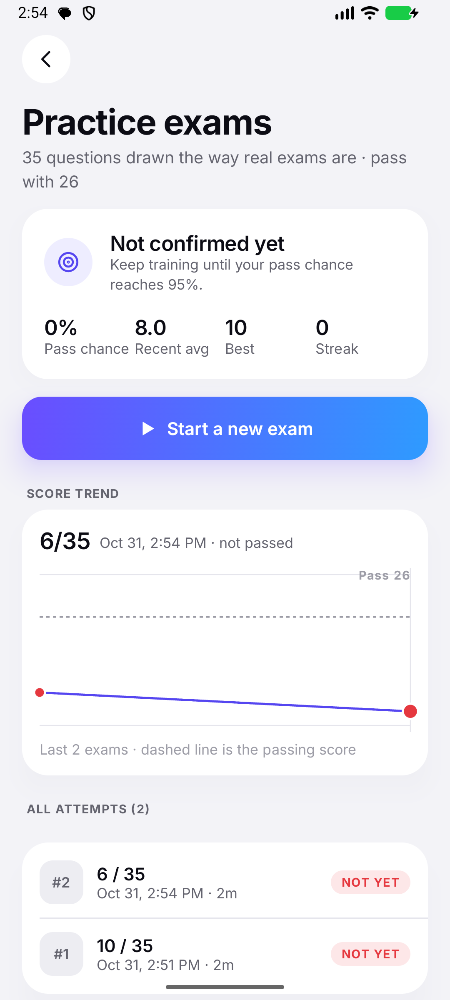

<p align="center">
  
</p>

<h1 align="center">HamSprint</h1>
<p align="center"><b>Get your US ham radio license. Fast.</b><br>
Technician · General · Amateur Extra. Current NCVEC pools, fully offline, free and open source.</p>

<p align="center">
  
  
  
  
</p>

HamSprint skips the theory. It trains exactly what's on the exam (the official
questions and their correct answers) and tells you, with a number you can trust,
when you're ready to pass.

## Download

- **GitHub Releases:** grab the latest signed `HamSprint-vX.Y.Z.apk` from
  [Releases](https://github.com/brianwebb01/hamsprint/releases/latest).
  It works on any Android 8.0+ device, including GrapheneOS.
- **F-Droid:** submission instructions are in [docs/FDROID.md](docs/FDROID.md).

## Question pools

| Exam | Pool | Revision | Questions | On exam | Pass |
|---|---|---|---|---|---|
| Technician (Element 2) | 2026-2030 | Feb 19, 2026 errata | 409 | 35 | 26 |
| General (Element 3) | 2023-2027 | 6th errata, Feb 4, 2026 | 423 | 35 | 26 |
| Amateur Extra (Element 4) | 2024-2028 | 4th errata, Feb 4, 2026 | 599 | 50 | 37 |

Every pool is generated from the official NCVEC Word documents
([`tools/pool/source/`](tools/pool/source)) by
[`tools/pool/build_pools.py`](tools/pool/build_pools.py). Withdrawn questions
are removed and figures are extracted from the documents themselves. The parsed
output was cross-checked question by question against an independent parse
([russolsen/ham_radio_question_pool](https://github.com/russolsen/ham_radio_question_pool)):
ids, answer keys, and text all match.

## How it trains you

The method is optimized for one outcome: passing the exam in the least study time.

1. **Preview, then recall.** A new question appears with its answer highlighted
   (no failed guess to unlearn). Three cards later you're asked for it. Retrieval
   practice beats re-reading.
2. **Spaced review.** Correct recalls push a question out on an expanding
   schedule (10 min → 1 h → 6 h → 1 d → 3 d → 8 d → 21 d). A miss sends it back
   to learning, and it returns within two cards.
3. **Exam-weighted ordering.** Real exams draw one question per topic group, so a
   question from a 10-question group is likelier to show up than one from a
   14-question group. New questions are introduced in exam-weight order, with
   topics interleaved.
4. **Working-memory limits.** At most five new questions are in flight at once.
   New material keeps flowing even when reviews pile up, so coverage of the pool
   never stalls.
5. **Shuffled answers.** You memorize the answer, not its letter.

### The pass chance

The exam score is a sum of independent draws, one question per group, so the
probability of passing is the upper tail of a Poisson-binomial distribution over
each group's mean recall. HamSprint computes that exactly from your progress
(`domain/Readiness.kt`). It calls you **ready at 95%** and then asks you to
confirm by passing two practice exams in a row.

### Evidence for "about four hours"

[`StudySimulationTest`](app/src/test/java/org/brianwebb/hamsprint/domain/StudySimulationTest.kt)
runs simulated learners through the real training engine. Their memory follows
[FSRS](https://github.com/open-spaced-repetition/fsrs4anki/wiki/The-Algorithm)
(the model behind Anki's scheduler, fit on hundreds of millions of reviews),
pessimistically set to "hard material". They study in 50-minute sittings, and the
next morning they're graded on fresh practice exams using their *true* memory:

| Exam | Study time to "ready" | Next-day practice-exam pass rate |
|---|---|---|
| General | 3 h 54 m to 3 h 56 m (5 runs) | 96.5 to 97.5% |
| Technician | ~3 h 52 m | 94.5 to 97.8% |
| Amateur Extra | ~5 h 40 m | 99.5 % |

These are simulations, not a guarantee. People vary, and the model makes
assumptions (≈8 to 9 s per card, for example). The in-app pass chance updates from
*your* answers, and the practice exams show you directly.

## Building

Requirements: JDK 17+ and the Android SDK (platform 36).

```sh
./gradlew testDebugUnitTest   # unit, Robolectric and simulation tests
./gradlew assembleDebug       # app/build/outputs/apk/debug/
./gradlew assembleRelease     # unsigned unless signing is configured (below)
```

Release signing reads `HAMSPRINT_KEYSTORE`, `HAMSPRINT_KEYSTORE_PASSWORD`,
`HAMSPRINT_KEY_ALIAS` and `HAMSPRINT_KEY_PASSWORD` from the environment, or a
git-ignored `keystore.properties` (`storeFile`, `storePassword`, `keyAlias`,
`keyPassword`). Without either, release builds are unsigned (that's what F-Droid
expects).

### Regenerating the pools

When NCVEC publishes new errata, drop the new `.docx` into `tools/pool/source/`,
update the `PoolSpec` in `build_pools.py`, then:

```sh
python3 -m pip install pillow
python3 tools/pool/build_pools.py
./gradlew testDebugUnitTest   # PoolLoaderTest pins counts and withdrawn ids
```

## Branches and releases

- `dev` is the integration branch. Open feature PRs against `dev`.
- `main` is release-only. **Merging a PR into `main` publishes a release**
  ([`.github/workflows/release.yml`](.github/workflows/release.yml)):
  - If the version in `app/build.gradle.kts` hasn't been released yet, it's
    released as-is. Otherwise the patch number is bumped automatically. Label the
    PR `release:minor` or `release:major` for a bigger bump.
  - The workflow commits the bump plus a fastlane changelog (written from the PR
    title) to `main`, tags `vX.Y.Z`, builds the signed APK, publishes a GitHub
    Release with the APK and its SHA-256, and fast-forwards `dev`.
- Every PR runs tests, lint and a debug build ([`ci.yml`](.github/workflows/ci.yml)).

## Architecture

Single module. The layering is strict and the domain is pure Kotlin.

```
ui/        Compose screens + ViewModels (no business rules)
domain/    Pool model, MemoryModel (schedule), TrainingSession (adaptive engine),
           Readiness (pass probability), Exam (generation, grading)
data/      PoolLoader (bundled JSON), ProgressStore (SQLite), SettingsStore
```

There are no analytics, ads or network calls, and no permissions.

## License

HamSprint is licensed under the [GNU GPL v3](LICENSE). The question pools are in
the public domain (released by the NCVEC Question Pool Committee). The Inter
typeface is under the [SIL Open Font License](licenses/Inter-OFL.txt). HamSprint
is not affiliated with the FCC, NCVEC, or ARRL.
